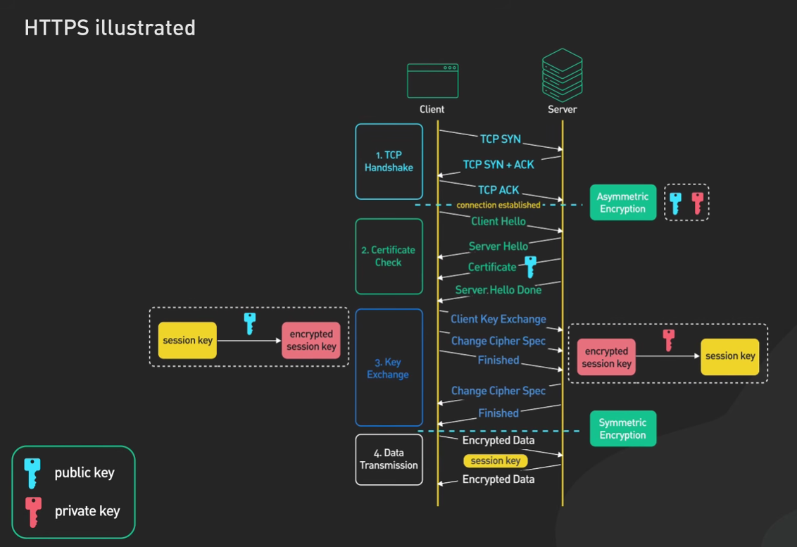
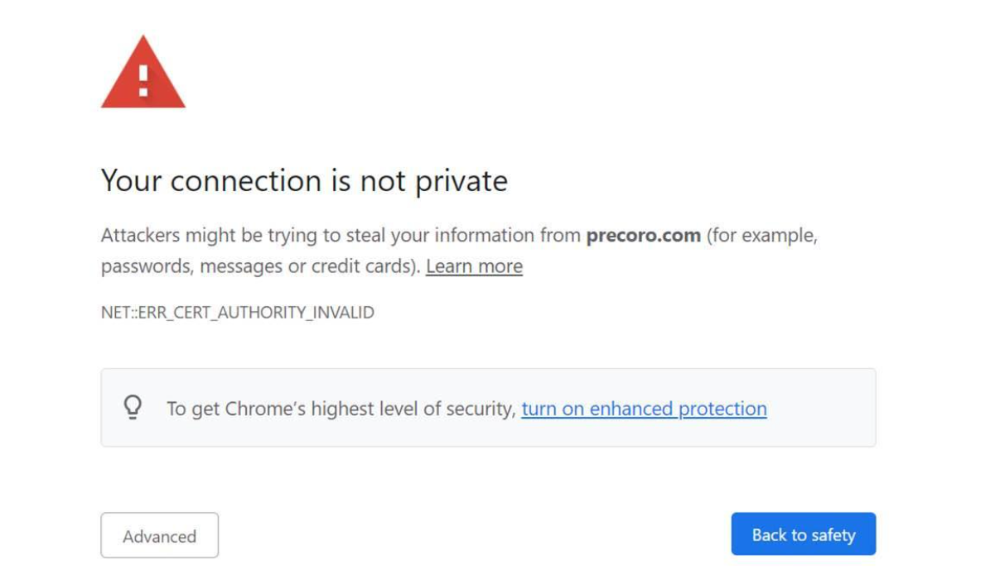

### SSL
- Introduced 1994
- Used till 2014
- 'Poddle Atack' happend in 2014
- Uses RC4 encryption
- *SIGNATURE = Public key of server + Public key of CA*
- YT LINK: https://youtu.be/0yw-z6f7Mb4?si=28F97SStyima7I3L

### TLS
- More secure because AES encryption was used and uses HMAC authentication

##### TLS Handshake
- Step 1: First create a TCP connection
- [TCP connection established]
- Step 2: client send: Client 'Hello' message
- Client hello message tell the browser:
    - which TLS version it can support (TLS 1.2, TLS 1.3)
    - What cyber suite it supports (it is a set of encryption algorithms used to encrypt the data)
- Step 3: Server send: Server 'Hello' message, certificate (with public key)
    - Here asymmetric encryption happens
- Step 4: Key exchange
    - Client sends a session key encrypted with servers public key
    - Server decrypts the sessioni key using its private key
    - Now client and server both has same session key
    - Here symmetric encryption happens
- Step 5: Data transmission (now client and server can send and receive data from each other)

##### In RSA-based TLS 1.2:
- The client generates a random value called the Pre-Master Secret (PMS).
- The client encrypts the PMS using the server's public key (obtained from its certificate).
- The client sends the encrypted PMS to the server.
- The server decrypts it using its private key.
- Both client and server independently derive the Master Secret from the PMS and the client/server random values.
- Both derive symmetric session keys from the Master Secret.

##### TLS 1.3
- It uses Diffe Hellman for key exchange instead of RSA (in TLS 1.2)

### SSL vs. TLS
- SSL and TLS have similar purposes, but different protocol designs.
- SSL was deprecated because its cryptographic mechanisms and protocol design had security weaknesses.
- TLS replaced SSL with improved security and performance.

#### Chain of Trust in SSL and TLS
- The Chain of Trust in SSL/TLS is a mechanism used to verify that a website's digital certificate is genuine and was issued by a trusted Certificate Authority (CA).
- In simple words, it establishes why your browser should trust the certificate presented by a server.

## Script
Explained all the attacks which happen on the web. Now I'll start with covering how, particularly, the web is secured from those attacks. I talk about all the techniques which are used to protect the web.
1. I'll start with covering what the difference is between HTTP and HTTPS.
2. I talk about what SSL and TLS certificates are.
3. What the two types of TLS handshake are.
4. I talk about how, particularly, HTTP protects the web and about its limitations.
5. We'll talk about secure sessions, cookies, and headers.
6. I'll talk about something which is called OWASP Top 10 2025.
7. We'll see how, particularly, an e-commerce application is secured from all the attacks.

HTTP is basically a protocol used on the web. When we talk about HTTP in the URL, it means that whenever we send URLs, form fields, passwords, cookies, and headers from the user side to the server, that data is sent clearly today without encrypting or hashing any fields.