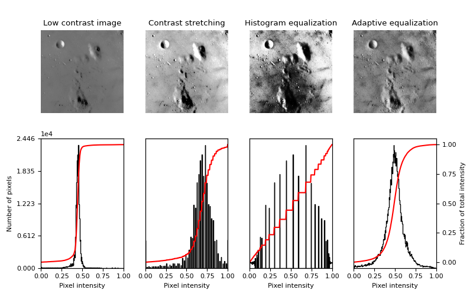
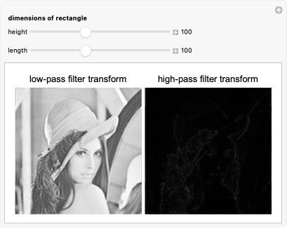
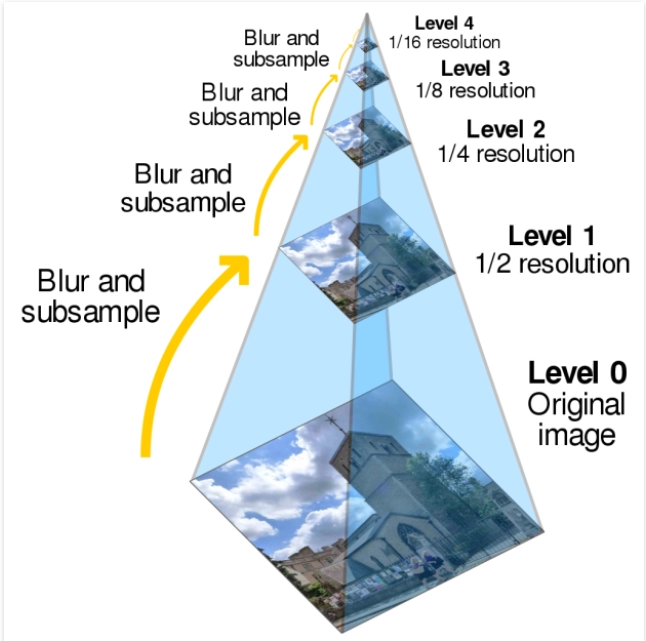

#### General Notes
- [Fourier Transformation](Notes/fourier.md)
- [Morpholocial Operations](PCT_PCM/PCT_PCM7%20Notes/PCT_PCM7_notes.md)
   - SE: Structuring Element
   - Binary Image
   - Erosion and Dilation
   - Opening and Closing
- [Case Study](Notes/CaseStudy.md)


#### Week wise notes
- [Week 1](Notes/Week1.md)
- [Week 2](Notes/Week2.md)
- [Week 3](Notes/Week3.md)
- [Week 4](Notes/Week4.md)

#### Contrast Stretching and Histogram Equalization


#### Low Pass/High Pass Filtering


#### Image Pyramid for Image resolution

```
Original
512×512
   ↓
Blur + ↓2
256×256
   ↓
Blur + ↓2
128×128
   ↓
Blur + ↓2
64×64


Here, ↓2 = downsampling
```